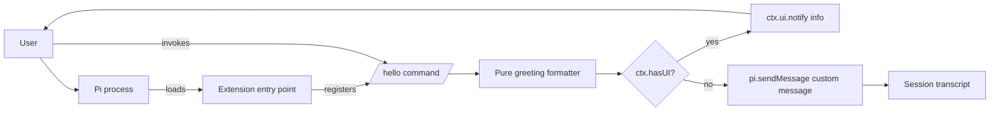

# Architecture

This repository is a small Pi extension template. It demonstrates a complete path from a command invocation to a visible result, with a thin Pi adapter, pure logic, and layered tests. It intentionally does not include a service, configuration, persistent state, or a build pipeline.

## Goals and non-goals

**Goals**

- A working extension that can be loaded from a checkout or a packed package.
- Pi-specific code isolated to a small adapter.
- Logic that can be tested without Pi, credentials, or network access.
- Checks for the package shape and for real Pi RPC and headless JSON processes.
- Documentation that a fork can delete or replace without untangling product-specific policy.

**Non-goals**

- Providing a framework or runtime dependency for other extensions.
- Demonstrating tools, resource files, configuration, subprocesses, or network clients.
- Guaranteeing behavior on operating systems other than Linux.
- Typechecking or linting TypeScript.

## System context

Pi owns the session, provider transport, command dispatch, and output protocol. The extension owns only the command registration, the formatting decision, and the choice of output channel. It does not call a model, open a connection, read a file, or retain state between invocations.

## Modules

| Module | Responsibility | Does not |
| --- | --- | --- |
| `src/index.ts` | Default-export the extension function; register `/hello`; call the formatter; choose notification versus custom message. | Format text or perform I/O. |
| `src/greeting.ts` | Pure formatting: trim the argument, fall back to `world`, return `Hello, NAME!`. | Import Pi, read configuration, or keep state. |
| `package.json` | Metadata, scripts, Pi entry-point manifest, and package allowlist. | Contain runtime dependencies in the starter. |
| `scripts/quality.json` | Pin the Pi version used by e2e and CI. | Configure the extension at runtime. |
| `test/` | Offline unit, wiring, and tooling tests, including temporary release-CLI fixtures and isolated local Node subprocesses. | Launch Pi, run `npm pack`, or use the network. |
| `e2e/` | Real-Pi checks for checkout RPC, headless JSON, and packed-archive loading. | Share fixtures or credentials with unit tests; run `pi install` or use a registry. |

The starter imports the host package for types only, which keeps its test process free of a runtime host dependency and makes the adapter replaceable with a fake. Runtime imports from a host peer are legitimate because Pi supplies that package; the type-only starter import is a testability choice, not a ban.

## Command flow

1. Pi loads the extension entry point. From a checkout, that is `pi -e ./src/index.ts`; from a package, Pi follows the manifest in `package.json`.
2. The default export receives an `ExtensionAPI` and registers `hello` with a description and handler.
3. Pi invokes the handler with the raw argument text and a command context.
4. `src/index.ts` passes the argument to the pure formatter.
5. The formatter trims the input. If the result is empty, it substitutes `world`; otherwise it uses the trimmed name. It returns the text in the `Hello, NAME!` shape.
6. If `ctx.hasUI` is true, the handler calls `ctx.ui.notify(text, "info")`. TUI and RPC modes have UI.
7. If `ctx.hasUI` is false, the handler calls `pi.sendMessage` with `customType: "template-greeting"`, `content: text`, and `display: true`, plus `{ triggerTurn: false }`. Print and JSON modes take this path. The message is visible but does not start a model turn.

This split keeps interactive feedback idiomatic without assuming a terminal. See [ADR 0001](adr/0001-thin-extension-and-layered-tests.md).

## Loading and packaging

A local checkout is loaded directly with `-e`; Pi handles TypeScript. For the packed path, e2e obtains a tarball (by packing the current tree, or via `PACKAGE_ARCHIVE` for an exact checked archive), lists it with system GNU-compatible `tar`, accepts only regular files and directories, extracts it, and loads the extracted directory through a temporary Pi `settings.json` `packages` entry. Pi discovers the command from the package manifest it finds there. The runner does not run `pi install` or contact a registry, so npm resolution and the install command are not covered.

Both loading paths are exercised because they fail differently:

- A checkout check misses packaging and manifest mistakes.
- A packed check that reused a stale tarball would miss current source, so the default e2e path packs the current tree. Release verification deliberately sets `PACKAGE_ARCHIVE` to test the exact archive that will be published.

The package is an allowlist: `package.json`, `README.md`, `LICENSE`, `CHANGELOG.md`, and non-hidden `src/**/*.ts` excluding `*.test.ts`, `*.spec.ts`, and `AGENTS.md`/`CLAUDE.md`/`GEMINI.md`. Development material is excluded deliberately. `npm run check:package` turns that intent into an assertion.

## Failure behavior

| Situation | Behavior |
| --- | --- |
| Blank or whitespace-only argument | The formatter returns `Hello, world!`. |
| Normal argument with surrounding whitespace | The formatter trims it and returns `Hello, NAME!`. |
| Interactive TUI or RPC mode | An info notification is shown. |
| Print or JSON mode | A visible custom message is added; no model turn starts. |
| Handler throws | Pi reports the extension error; there is no hidden fallback. Keep the handler small enough to avoid this. |
| Pi binary missing or version-mismatched in e2e | The e2e runner fails before exercising the extension. Use an absolute `PI_BIN`; its version must match `scripts/quality.json` unless `PI_VERSION` is set for a temporary experiment. |
| Packed archive has non-file entries or system tar is unavailable | The archive check fails before Pi loads it; use a GNU-compatible `tar` and a package containing only regular files and directories. |
| Extra file added to the package | `npm run check:package` fails; fix the allowlist deliberately or remove the file. |

The starter has no background work to cancel and no persistent resource to clean up. If a fork adds a subprocess, server, timer, temporary file, or open handle, cancellation and cleanup become part of this table and require tests.

## Security and data

- The example reads no environment variables, files, or Pi configuration.
- It makes no network request and does not invoke a model.
- It emits only the greeting text to the Pi UI or session message; it does not log arguments or session content.
- Extensions run with Pi's operating-system permissions. Installing an extension is a trust decision.
- Packaging excludes agent instructions, tests, e2e files, docs, environment files, and credentials.

See [`../SECURITY.md`](../SECURITY.md).

## Compatibility and quality

- Node.js 22.18+ is required for development and the test runner.
- Pi 1.5.2 is the baseline in `scripts/quality.json`; CI installs that version into a temporary prefix outside the checkout, which requires network. Test execution itself is offline.
- CI runs the checks on Node 22 and 24 on Linux; local verification here uses Node 22. Other platforms are unverified.
- There is no lint, typecheck, or build. Node strips TypeScript types without checking them, so runtime tests and review carry the correctness burden.
- `npm run check` covers unit, wiring, tooling, and package contents. `npm run test:e2e` covers real Pi loading, command discovery, and the headless custom-message path.

See [`TESTING.md`](TESTING.md) for the test layers and [`TEMPLATE-SETUP.md`](TEMPLATE-SETUP.md) for adapting the template.

## Decisions

- [ADR 0001: Thin extension and layered tests](adr/0001-thin-extension-and-layered-tests.md)
