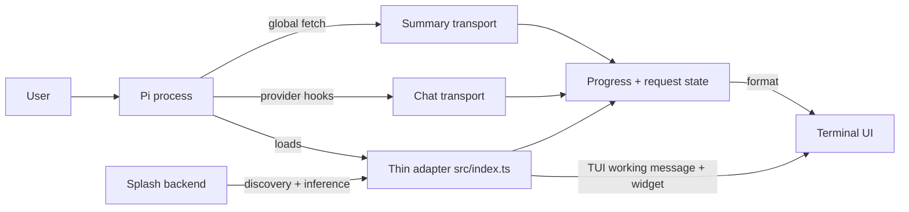
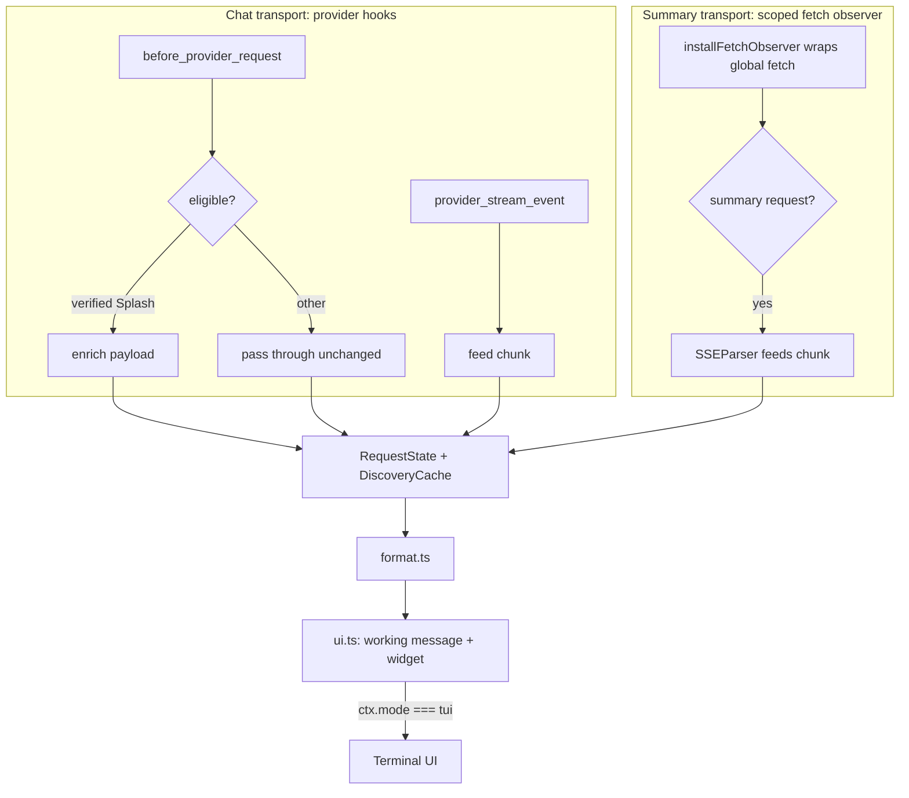

# Architecture

`pi-splash-stats` is a Pi extension that observes inference traffic to a verified OpenAI-compatible
**Splash** backend and renders two transient status lines in the interactive terminal UI: a
cache-aware prefill progress bar and a live generation token count. It is a passive observer: it
enriches and watches requests Pi already sends, then renders in the TUI only. It does not call a
model, read configuration, or keep state between invocations, and it is completely silent in
RPC, print, and JSON modes.

The architecture keeps the Pi surface in one thin adapter and pushes all behavior into pure modules
that are tested directly, with a scoped fetch observer for the one transport the provider hooks do
not cover. See [ADR 0001](adr/0001-thin-extension-and-layered-tests.md) and
[ADR 0002](adr/0002-transport-coverage.md).

## Goals and non-goals

**Goals**

- A passive, TUI-only observer of Splash inference: prefill progress and generation count.
- Pi-specific code isolated to a single thin adapter (`src/index.ts`).
- Behavior that is testable without Pi, credentials, or the network.
- Ownership guarantees: late or out-of-order chunks cannot corrupt the active request's counts, and
  concurrent streams cannot mix.
- Graceful failure: a UI error, an abrupt stream, or a failed discovery never fails the underlying
  request.
- Checks for the package shape and for real Pi RPC, headless JSON, and packed-archive loading.

**Non-goals**

- Providing a framework or runtime dependency for other extensions.
- Showing every configuration option, or reading any configuration at all.
- Guaranteeing behavior on operating systems other than Linux (CI).
- Typechecking or linting TypeScript.
- Replacing Pi's provider transport, compaction, or UI.

## System context

Pi owns the session, provider transport, command dispatch, compaction, and output protocol. The
extension owns only two transient TUI surfaces (a working message and a widget), both keyed to the
extension, and the in-memory request/discovery state for the current session. It makes no model call
of its own and retains no state after shutdown.

## Modules

| Module | Responsibility | Does not |
| --- | --- | --- |
| `src/index.ts` | Thin Pi adapter. Wires lifecycle events (`session_start`, `model_select`, `session_shutdown`), the provider request/stream hooks, and the TUI working-message/widget registration. Gates all rendering on `ctx.mode === "tui"`. Owns the `RuntimeState`. | Format text, do statistics math, own the discovery cache, or touch the network. |
| `src/identity.ts` | Pure identity rules: endpoint normalization, discovery URL, candidate test, and identity-response validation (SPECIFICATION §5.1–5.4). | Make requests or cache anything. |
| `src/discovery.ts` | Bounded, deduplicated, cached Splash discovery: 2s deadline, 60s success / 5s failure cache, auth-context key (SPECIFICATION §5.3). | Format or render. |
| `src/transport.ts` | Request eligibility, payload enrichment, and stream attribution (SPECIFICATION §6, §9). | Render or own UI. |
| `src/progress.ts` | The statistics math: prefill state/snapshot, generation state, request state, and validation bounds (SPECIFICATION §7). | Touch the network or UI. |
| `src/format.ts` | Compact-line rendering: bar, percent, count, rate, ETA, with width fallbacks (SPECIFICATION §8.2). | Compute statistics. |
| `src/ui.ts` | Working-message and widget ownership, update coalescing (≤10/sec), and throw-safe display (SPECIFICATION §8.1, §8.3, §10.3). | Compute statistics or format raw numbers. |
| `src/fetch-observer.ts` | A scoped global `fetch` observer and SSE parser used for compaction and branch summaries, which do not fire the provider hooks (SPECIFICATION §10.2). See ADR 0002. | Enrich requests or render. |
| `package.json` | Metadata, scripts, Pi entry-point manifest (`pi.extensions: ["./src/index.ts"]`), and package allowlist. | Contain runtime dependencies. |
| `scripts/quality.json` | Pin the Pi version used by e2e and CI. | Configure the extension at runtime. |

The adapter imports the host package for **types only** (`import type`), so its unit tests do not need
Pi installed. A runtime import from a host peer is legitimate because Pi supplies it; the type-only
import is a testability choice, not a ban on host packages.

## Request flow

Two transports feed the same request/progress state, because Pi's provider hooks fire for chat but
not for compaction or branch summaries.

1. **Eligibility and enrichment (chat).** On `before_provider_request`, the adapter checks whether the
   target is a verified Splash backend (via the discovery cache). If so, it enriches the payload
   (`return_progress`, `stream_options.include_usage`); otherwise the request is sent unchanged.
2. **Prefill and generation (chat).** On `provider_stream_event`, chunks are fed to the active
   `RequestState`. The prefill phase accumulates a cache-aware progress snapshot; once generation
   starts, the token count is updated. Updates are coalesced to ≤10/sec; phase changes and cleanup
   render immediately.
3. **Summaries (fetch observer).** Compaction and branch summaries do not fire the provider hooks.
   `installFetchObserver` wraps the global `fetch` for the scoped summary endpoint, parses the SSE
   stream, and feeds the same `RequestState`. See [ADR 0002](adr/0002-transport-coverage.md).
4. **Render (TUI only).** The `UiController` owns a working message and a widget, keyed to the
   extension, and renders the formatted line. Rendering happens only when `ctx.mode === "tui"`.

## Mode gating

All rendering is gated on `ctx.mode === "tui"` — not `ctx.hasUI` alone. RPC, print, and JSON modes
produce no statistics messages, no terminal output, no notifications, no transcript entries, and no
protocol additions (SPECIFICATION §8.4, AC-13). Enrichment and observation still run in those modes
when a request is eligible, but nothing is displayed.

## Lifecycle and ownership

The extension tracks request ownership so that late, out-of-order, or stale chunks cannot corrupt
counts or mix concurrent streams (SPECIFICATION §9).

- **`runtimeGeneration`** is captured per request and incremented on `session_start` (a fresh
  runtime).
- **`selectionGeneration`** is incremented on `model_select`.
- Each request is **armed** with its identity tuple `(runtimeGeneration, selectionGeneration,
  endpoint, modelId, provider, api)`. A stream chunk is attributed only if it matches the active
  request's identity.
- **`armedRequest`** is a safety net: a stale boundary event (e.g. a late `done`) cannot clear a
  newer active request.
- **`DiscoveryCache`** lives in the `RuntimeState`, is disposed on `session_shutdown`, and is reset on
  `session_start`.

`RuntimeState` = `{ runtimeGeneration, selectionGeneration, activeRequest, armedRequest, ui,
discovery, disposed }`. `RequestState` (in `progress.ts`) = `{ id, runtimeGeneration,
selectionGeneration, endpoint, modelId, provider, api, phase, prefill, prefillSnap, generation,
generationStarted, finalized }`.

## Loading and packaging

A local checkout is loaded directly with `-e`; Pi handles TypeScript. For the packed path, e2e
obtains a tarball (by packing the current tree, or via `PACKAGE_ARCHIVE` for an exact checked
archive), lists it with a portable system `tar` (`tar -tf`; no GNU-only flags), accepts only regular
files and directories, extracts it, and loads the extracted directory through a temporary Pi
`settings.json` `packages` entry. Pi loads the extension from the package manifest it finds there.
The runner does not run `pi install` or contact a registry, so npm resolution and the install command
are not covered.

Both loading paths are exercised because they fail differently:

- A checkout check misses packaging and manifest mistakes.
- A packed check that reused a stale tarball would miss current source, so the default e2e path packs
  the current tree. Release verification deliberately sets `PACKAGE_ARCHIVE` to test the exact archive
  that will be published.

The package is an allowlist: `package.json`, `README.md`, `LICENSE`, `CHANGELOG.md`, and non-hidden
`src/**/*.ts` excluding `*.test.ts`, `*.spec.ts`, and `AGENTS.md`/`CLAUDE.md`/`GEMINI.md`.
Development material is excluded deliberately. `npm run check:package` turns that intent into an
assertion.

## Failure behavior

| Situation | Behavior (SPECIFICATION §11) |
| --- | --- |
| UI API throws | The affected display (working message or widget) is disabled; the request is never failed. |
| Stream cut off abruptly | The display is cleared; no unhandled rejection. |
| Discovery fails or times out (2s) | The original request is sent unchanged (no enrichment); the failure is cached for 5s. |
| Non-Splash provider | The request is not enriched and no statistics are shown. |
| Late / out-of-order / stale chunk | Rejected; it does not alter the active request's counts. |
| Concurrent streams | Counts are attributed by request identity and cannot mix. |
| `session_shutdown` | The discovery cache is disposed and the runtime is inert. |
| `session_start` | A fresh discovery cache is created and `runtimeGeneration` is incremented. |

There is no background work to cancel and no persistent resource to clean up. The only async surface
is the bounded discovery request, which has a 2s deadline.

## Security and data

- The extension reads no environment variables, files, or Pi configuration.
- It makes a single bounded, cached discovery request to the Splash backend (2s deadline) to verify
  provider identity; it makes no other network calls and does not call a model.
- It emits no output in non-TUI modes and logs nothing.
- It keeps no state between invocations; the discovery cache is in-memory and per-session.
- Extensions run with Pi's operating-system permissions. Installing an extension is a trust decision.
- Packaging excludes agent instructions, tests, e2e files, docs, environment files, and credentials.

See [`../SECURITY.md`](../SECURITY.md).

## Compatibility and quality

- Node.js 22.18+ is required for development and the test runner.
- Pi 1.5.2 is the baseline in `scripts/quality.json`; CI installs that version into a temporary prefix
  outside the checkout, which requires network. Test execution itself is offline.
- CI runs the checks on Node 22 and 24 on Linux; local verification here uses Node 22. Other
  platforms are unverified.
- There is no lint, typecheck, or build. Node strips TypeScript types without checking them, so
  runtime tests and review carry the correctness burden.
- `npm run check` covers unit, wiring, tooling, and package contents. `npm run test:e2e` covers real
  Pi loading, command discovery (asserting the package contributes no commands of its own), and the
  silent headless JSON path.

See [`TESTING.md`](TESTING.md) for the test layers and the real-Pi verification harness.

## Decisions

- [ADR 0001: Thin extension and layered tests](adr/0001-thin-extension-and-layered-tests.md)
- [ADR 0002: Transport coverage (provider hooks + scoped fetch observer)](adr/0002-transport-coverage.md)
